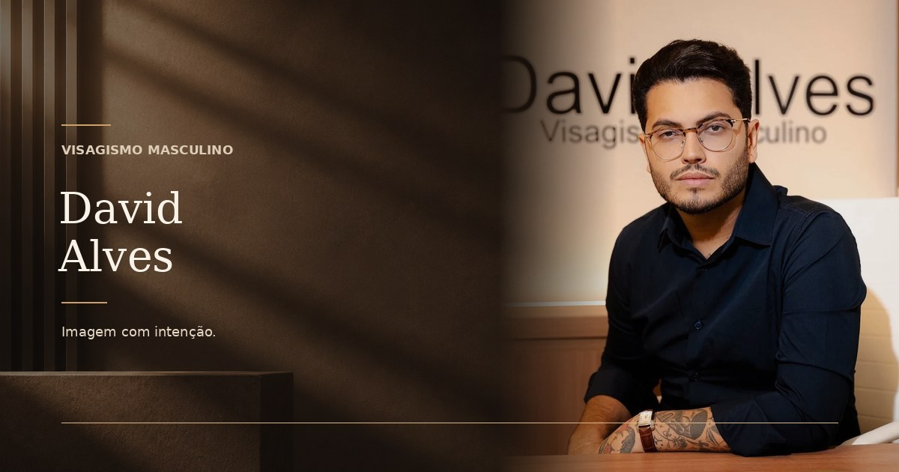

<div align="center">

  

  # David Alves — Visagismo Masculino

  **Uma experiência digital desenvolvida para valorizar a identidade, apresentar o trabalho e aproximar clientes.**

  
  
  
  

</div>

---

## Sobre o projeto

O projeto consiste em um site institucional desenvolvido para **David Alves**, profissional especializado em visagismo masculino.

A proposta é construir uma presença digital que transmita profissionalismo, sofisticação e identidade, apresentando os serviços, trabalhos realizados e a filosofia profissional de maneira visual e intuitiva.

A interface foi planejada para proporcionar uma experiência consistente em diferentes dispositivos, combinando elementos visuais, animações e navegação fluida.

## Funcionalidades

- **Apresentação institucional:** introdução à identidade e à filosofia profissional.
- **Visagismo:** explicação da abordagem e dos conceitos do trabalho.
- **Portfólio:** apresentação de trabalhos e resultados.
- **Antes e depois:** comparação visual dos resultados.
- **Serviços:** apresentação das modalidades de atendimento.
- **Processo de atendimento:** etapas da experiência do cliente.
- **Conteúdo audiovisual:** seção com vídeos e publicações.
- **Instagram:** integração com o perfil profissional.
- **WhatsApp:** botões de contato com mensagens contextualizadas.
- **Formulário de atendimento:** coleta de informações e encaminhamento para o WhatsApp.
- **Design responsivo:** adaptação para computadores, tablets e smartphones.

## Experiência visual

O projeto utiliza uma identidade visual cuidadosamente construída, com atenção especial à tipografia, composição, espaçamento e hierarquia das informações.

Entre os recursos implementados estão:

- Animações de entrada e transições.
- Revelação progressiva de elementos durante a navegação.
- Efeitos visuais associados à rolagem.
- Microinterações em botões e elementos interativos.
- Apresentação dinâmica de imagens e vídeos.
- Indicadores de navegação e progresso da página.

## Tecnologias utilizadas

| Tecnologia | Aplicação |
|---|---|
| React 19 | Construção da interface |
| Vite 6 | Desenvolvimento e compilação |
| JavaScript | Lógica e interatividade |
| CSS3 | Estilização e animações |
| HTML5 | Estrutura e semântica |

## Estrutura do projeto

```text
david-alves-site/
│
├── public/
│   ├── images/
│   ├── videos/
│   ├── favicon.svg
│   ├── privacidade.html
│   └── og-david-alves.jpg
│
├── src/
│   ├── components/
│   │   ├── atoms/
│   │   ├── molecules/
│   │   ├── organisms/
│   │   └── templates/
│   │
│   ├── config/
│   ├── hooks/
│   ├── pages/
│   ├── styles/
│   ├── utils/
│   ├── App.jsx
│   └── main.jsx
│
├── scripts/
├── index.html
├── package.json
└── vite.config.js
```

## Executar localmente

É necessário ter Node.js e npm instalados.

Clone o repositório:

```bash
git clone URL_DO_REPOSITORIO
```

Acesse a pasta:

```bash
cd david-alves-site
```

Instale as dependências:

```bash
npm ci
```

Inicie o ambiente de desenvolvimento:

```bash
npm run dev
```

## Compilação de produção

Para gerar a versão otimizada:

```bash
npm run build
```

Os arquivos finais serão disponibilizados na pasta `dist/`.

Para visualizar a versão de produção localmente:

```bash
npm run preview
```

## Configuração

As principais informações do site são organizadas em arquivos específicos:

| Arquivo | Responsabilidade |
|---|---|
| `src/config/content.js` | Textos, seções e mensagens do WhatsApp |
| `src/config/site.js` | Informações institucionais e contato |
| `src/config/images.js` | Imagens e descrições |
| `src/config/motion.js` | Configurações de animação |
| `src/styles/tokens.css` | Identidade visual e variáveis de estilo |

## Privacidade e comunicação

O formulário de atendimento utiliza o WhatsApp como canal de comunicação.

As informações preenchidas são organizadas em uma mensagem e encaminhadas para o aplicativo, onde o visitante pode revisar e confirmar o envio.

O projeto não utiliza banco de dados para armazenar os contatos enviados pelo formulário e não possui integração com Google Analytics.

Também está disponível uma página dedicada à Política de Privacidade.

---

<div align="center">

  **David Alves — Visagismo Masculino**

  Projeto de presença digital e apresentação profissional.

</div>
